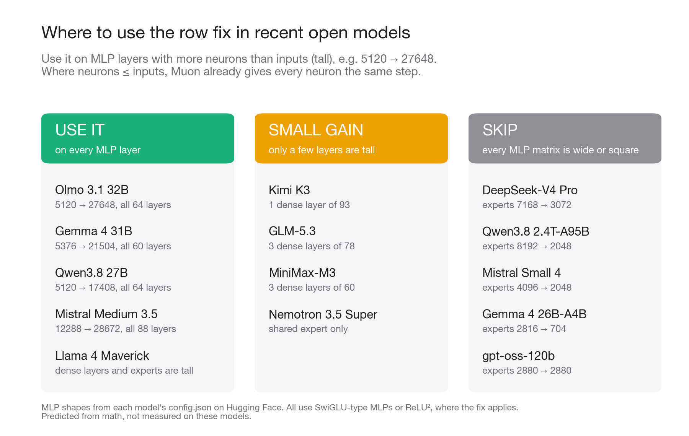
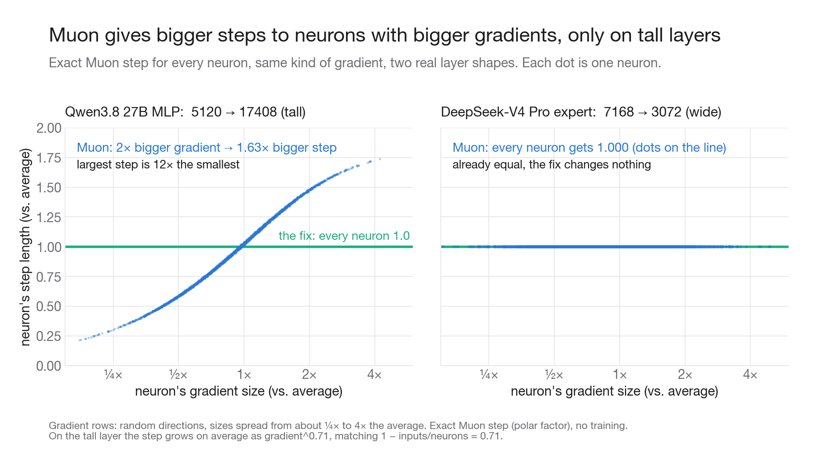
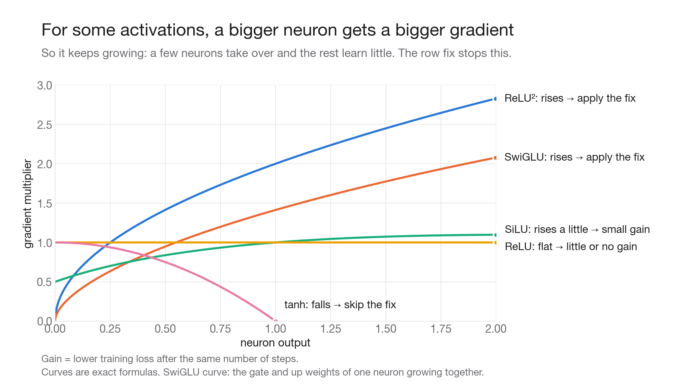

# Muon row fix

On a **tall** weight matrix (more rows than columns, like an MLP up-projection 5120 → 27648), Muon gives a neuron with a bigger gradient a bigger step. With activations whose slope grows with the neuron's output (ReLU², SwiGLU), a bigger neuron also gets a bigger gradient, so the same neurons keep getting bigger steps. **This repo asks: when does setting every row of Muon's update to the same length help, and where should it go?**

The fix, after Newton–Schulz, tall matrices only (same as Aurora's U-NorMuon):

```python
if O.shape[0] > O.shape[1]:
    O = O / O.norm(dim=1, keepdim=True) * O.norm() / O.shape[0] ** 0.5
```

| model (config.json, Oct 2026) | MLP shape (hidden → neurons) | use the fix? |
|---|---|---|
| Olmo 3.1 32B, Gemma 4 31B, Qwen3.8 27B, Mistral Medium 3.5 | dense, 2.3–5.4× tall, every layer | yes, every MLP layer |
| Llama 4 Maverick | dense 5120 → 16384, experts 5120 → 8192 | yes |
| Kimi K3, GLM-5.3, MiniMax-M3 | 1–3 dense tall layers; experts wide | only those few layers |
| Nemotron 3.5 Super (ReLU²) | shared expert 4096 → 5376; experts wide | shared expert only |
| DeepSeek-V4 Pro, Qwen3.8 2.4T-A95B, Mistral Small 4, Gemma 4 26B-A4B, gpt-oss-120b | experts wide or square, no dense layers | no: rows are already equal |



Why the shape decides it: at Qwen3.8 27B's shape (17408 × 5120), a neuron's Muon step grows as gradient^0.71 (exact computation, predicted 1 − 5120/17408 = 0.706), so 2× the gradient gives a 1.63× bigger step and the largest step is 12× the smallest. At DeepSeek-V4 Pro's expert shape (3072 × 7168), every step is exactly 1.000.



Why the activation decides it: the gradient reaching a neuron is multiplied by the activation's slope. ReLU²'s slope is 2x, so a bigger neuron gets a bigger gradient and the loop feeds itself. tanh's slope falls for big outputs, so it limits itself.



Published results for this kind of fix:

- **Aurora** (arXiv 2606.27715): U-NorMuon, this exact fix, 340M val loss 2.561 vs Muon 2.591. Tested on SwiGLU and ReLU².
- **NorMuon** (arXiv 2510.05491): row normalization with a running average, on all matrices. 11.3% fewer steps than Muon at 1.1B; also run at 5.4B.

## Use it

- `roweq.py`: `roweq(O)` drop-in after Muon's Newton–Schulz call; `python3 roweq.py` runs its checks.
- `realshape.py`: the step-length experiment at the two real shapes (about 1 minute on a laptop CPU).
- `math/row-math-notes.md`: the math (row length = leverage, sensitivity exponent 1 − n/m, which activations feed back, MoE experts, Newton–Schulz bound), each claim marked PROVEN / CHECKED / CONJECTURE.
- `math/row_math_checks.py`: the numerical check behind every number in the notes (`python3 math/row_math_checks.py c1`).
- `configs/`: the Hugging Face config.json files used for the table; `cfgkeys.py` prints their MLP fields.
- `charts/`: the charts and the scripts that draw them.

## Limits

- The verdicts for these models are predicted from shapes and math, not measured by training them.
- 5-step Newton–Schulz leaves small row differences on wide matrices too (CV ≈ 0.1); NorMuon found all-matrix normalization better than tall-only at 1.1B.
- The gains in the math notes' tables come from small training runs that are not in this repo.
- The "few neurons take over" story is a toy-model result; how far real networks follow it is a conjecture.

MIT license.
